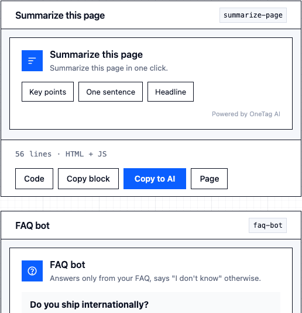

# Static AI Block

[](https://fengyiqicoder.github.io/static-ai-block/)

**Twelve copy-paste AI blocks for any static website. Plain HTML and JavaScript, one script tag, no backend.**

Try every block live: **https://fengyiqicoder.github.io/static-ai-block/**

```html
<script src="https://onetagai.com/v1.js" data-key="YOUR_ONETAG_KEY"></script>
```

Using an AI coding tool? Paste this to it: *"Add a block from https://fengyiqicoder.github.io/static-ai-block/llms.txt to my site, sign me up for a OneTag AI key with my email, and wire it in."*

## Blocks

| Block | What it does |
| --- | --- |
| [Summarize this page](https://fengyiqicoder.github.io/static-ai-block/b/summarize-page.html) | Summarize this page in one click. |
| [Ask this page](https://fengyiqicoder.github.io/static-ai-block/b/ask-this-page.html) | Ask anything about this page and get an answer from it. |
| [FAQ bot](https://fengyiqicoder.github.io/static-ai-block/b/faq-bot.html) | Answers only from your FAQ, says "I don't know" otherwise. |
| [Rewrite](https://fengyiqicoder.github.io/static-ai-block/b/rewrite.html) | Make any text shorter, longer, formal or friendly. |
| [Translate this page](https://fengyiqicoder.github.io/static-ai-block/b/translate-page.html) | Translate the whole page into another language. |
| [Draft a reply](https://fengyiqicoder.github.io/static-ai-block/b/draft-reply.html) | Paste a message, get a reply in the tone you pick. |
| [Extract to JSON](https://fengyiqicoder.github.io/static-ai-block/b/extract-json.html) | Turn messy text into structured fields. |
| [Smart search](https://fengyiqicoder.github.io/static-ai-block/b/smart-search.html) | Search a list in plain words; matches light up. |
| [Explain any selection](https://fengyiqicoder.github.io/static-ai-block/b/explain-selection.html) | Select any text on the page to get it explained. |
| [Describe an image](https://fengyiqicoder.github.io/static-ai-block/b/describe-image.html) | Get alt text for any image. |
| [Quiz from this page](https://fengyiqicoder.github.io/static-ai-block/b/quiz.html) | Turn this page into a three-question quiz. |
| [Explain code](https://fengyiqicoder.github.io/static-ai-block/b/code-explain.html) | Adds an Explain button to every code block. |

Each block is one HTML file in [`blocks/`](blocks/): copy it, paste it into any page, replace `YOUR_ONETAG_KEY`. The gallery's **Copy block** button copies the file; **Copy to AI** copies it together with the setup steps for Cursor, Claude Code or any coding agent.

## Get a free key

Fill in your email at [onetagai.com](https://onetagai.com/?ref=static-ai-block), or run this; the key arrives in that inbox (one key per email):

```bash
curl -X POST https://onetagai.com/api/signup -H "Content-Type: application/json" -d '{"email":"you@example.com"}'
```

Every account gets 1,000,000 free tokens. The key is public by design, like an analytics ID: it can only spend that allowance.

## How a block works

Every block loads the OneTag AI script and calls `onetag.ask(prompt, input, options)` from the browser. `input` can be a string, any element on the page (its text), a form, an image, or a plain object. Answers can stream in, or come back as parsed JSON with `json: true`. Nothing runs on your server; the site stays static.

## Add a block

Drop an `.html` file into `blocks/` whose first line is `<!-- Title: one-sentence description. -->`, keep the key comment and script tag at the top, run `node build.mjs`, and it appears in the gallery with its own page. Blocks should be self-contained: no dependencies, inline styles, under 60 lines.

## Powered by OneTag AI

The blocks call [OneTag AI](https://onetagai.com/?ref=static-ai-block) from the browser, so the site stays static: no server, no API key in the page, a free allowance of 1,000,000 tokens per account. The blocks are MIT; point them at any compatible endpoint if you run your own.

## License

MIT.
